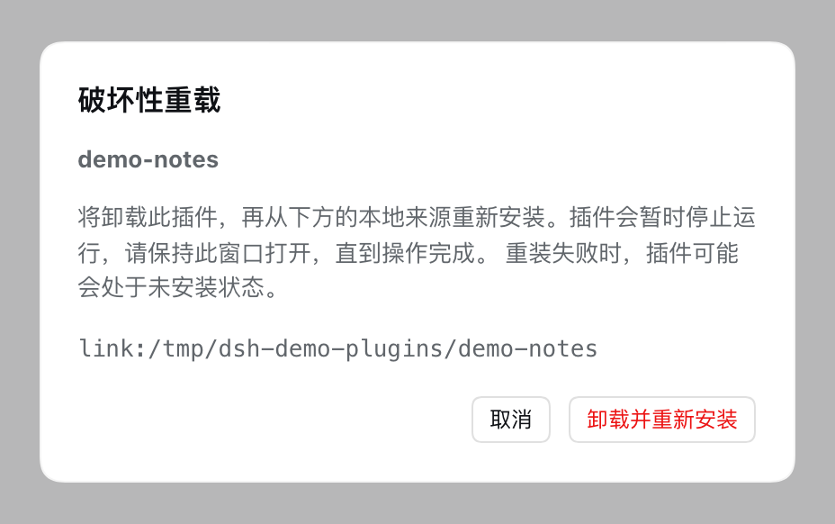

# Local plugin reload

[简体中文](README.zh.md)

Browse locally installed bundles in **Plugins → Local**, uninstall disabled removable bundles directly from the tab,
and edit sources or run **Destructive reload** from a bundle's detail page (click **Local** beside the title
or expand **Local reload** at the bottom; accepts absolute paths with optional `link:` or `file:` prefixes).

Keep the window open until **Destructive reload** completes; local archives must match the currently installed version
because source validation checks file existence only.

Requires DeepSeek Harness `0.2.2-rc.5` or newer.
Enable **Local plugin reload** in **Plugin Modular Improvement Plan**, or run `pnpm install` in this directory
and select it in **Plugins → Add plugin**.

## Screenshots

The **Local** tab and the **Destructive reload** confirmation for a demo bundle (Chinese UI;
reinstall was not confirmed).

[Main view in dark mode](docs/assets/screenshots/main-dark.png) · Local tab
([light](docs/assets/screenshots/entry-light.png) / [dark](docs/assets/screenshots/entry-dark.png))

[Project documentation](docs/README.md)
