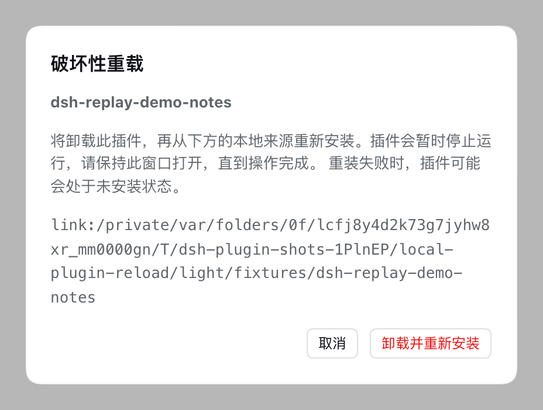

# 本地插件重载

[English](README.md)

在 **插件 → 本地** 页签浏览本地安装的插件。
每张卡片的标题旁都有 **本地** 徽章，右侧开关可启用或停用插件，点击卡片可打开原生详情页。
停用可卸载的插件后，点击卡片上的红色垃圾桶并确认即可卸载，完成后仍留在「本地」页签。
在可卸载插件的详情页，展开底部的 **本地重载**，或点标题旁的 **本地** 徽章直接跳过去。
点铅笔图标可编辑来源地址，再点 **破坏性重载** 并确认。
DSH 会检查地址，再卸载插件并从所选地址安装，沿用原来的启用状态。
地址接受绝对路径以及 `link:` 和 `file:` 格式。

请在操作完成前保持窗口打开。若卸载成功但重装失败，可以重试安装或从原地址恢复。
本地压缩包只检查文件是否存在，因此重装要求包内版本与当前安装版本相同。

需要 DeepSeek Harness 0.2.2-rc.5 或更新版本。
从源码安装时，先在检出目录运行 `npm ci` 构建插件，再在 **插件** > **添加插件** 中选择该目录。

## 实拍截图

「本地」页签和演示插件的「破坏性重载」确认框。
拍摄时没有确认重装。

[深色模式主图](docs/assets/screenshots/main-dark.png) · 「本地」页签 ([浅色](docs/assets/screenshots/entry-light.png)
/ [深色](docs/assets/screenshots/entry-dark.png))

[项目文档](docs/README.md)
